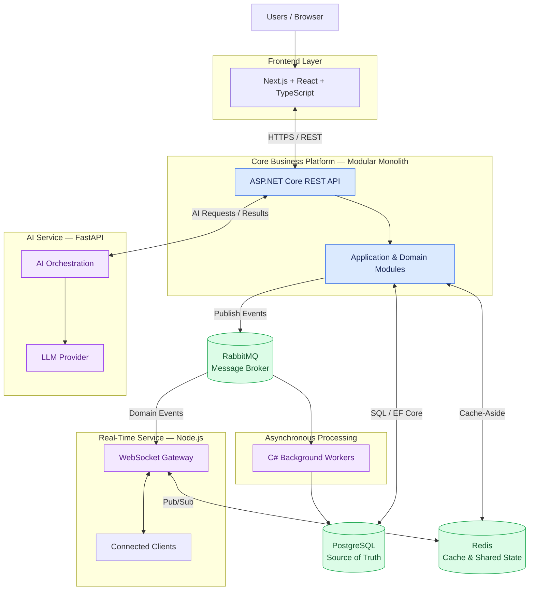

## High-Level System Architecture

Orbit is designed to evolve from a modular monolith into a distributed, full-stack application. The core business logic remains in ASP.NET Core, while specialized services handle AI processing and real-time communication.

### Architecture Overview

### Component Responsibilities

| Component    | Responsibility                                                    |
| ------------ | ----------------------------------------------------------------- |
| Next.js      | User interface, routing, rendering and frontend performance       |
| ASP.NET Core | Authentication, authorization, validation and core business rules |
| PostgreSQL   | Persistent application data and transactional integrity           |
| Redis        | Caching, rate limiting and shared ephemeral state                 |
| RabbitMQ     | Asynchronous events and background job delivery                   |
| C# Workers   | Background processing, retries and scheduled work                 |
| FastAPI      | AI orchestration, structured outputs and LLM integration          |
| Node.js      | WebSockets, presence and real-time event delivery                 |

### Architecture Principles

- **Single source of truth:** PostgreSQL owns durable business data.
- **Clear service boundaries:** AI and real-time services do not independently own core business rules.
- **Asynchronous by design where appropriate:** Slow or independent work can be moved out of HTTP request processing.
- **Measured scaling:** Caching, additional service instances and infrastructure are introduced when justified by requirements or experiments.
- **Observable and testable:** Services will eventually expose structured logs, metrics, traces and health checks.

### Evolution Strategy

1. **V0 — Full-stack monolith:** Next.js, ASP.NET Core and PostgreSQL.
2. **V1 — Production foundations:** Authentication, authorization, testing and error handling.
3. **V2 — Performance:** Query optimization, pagination and frontend profiling.
4. **V3 — Caching:** Redis and rate limiting.
5. **V4 — Asynchronous processing:** RabbitMQ and C# workers.
6. **V5 — AI integration:** FastAPI and an LLM provider.
7. **V6 — Real-time collaboration:** Node.js and WebSockets.
8. **V7 — Distributed operation:** Multiple API instances, resilience, observability and failure testing.

The diagram represents the **intended target architecture**, not the current implementation. Each component will be introduced incrementally as Orbit evolves.
