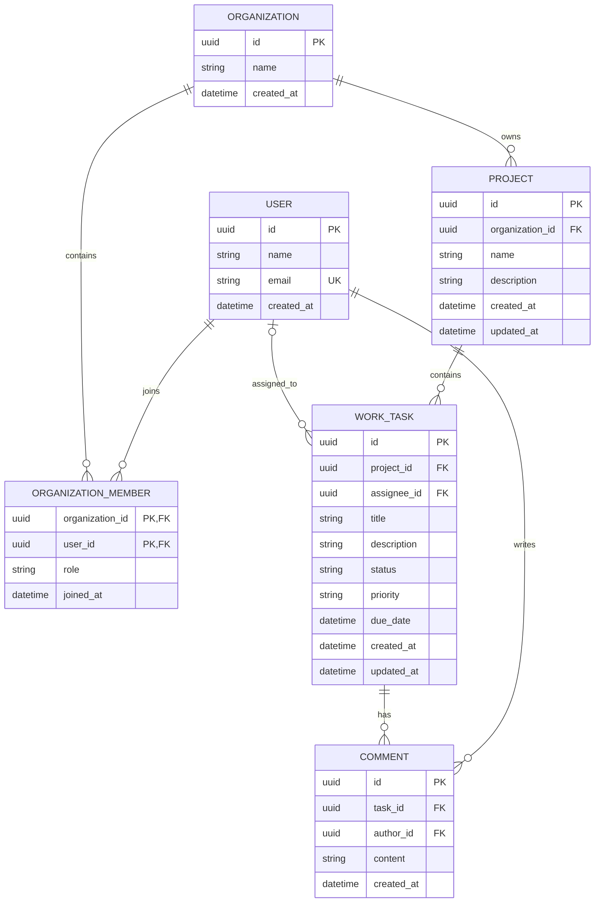

# Orbit — Initial Data Model

## 1. Overview

Orbit is a collaborative project and task management platform. This document defines the initial relational data model for V0.

The database will use **PostgreSQL**, with **Entity Framework Core (EF Core)** managing schema migrations and database access from the ASP.NET Core backend.

The model is intentionally small. Additional entities will be introduced as the product evolves.

## 2. Entity Relationship Diagram

## 3. Entities and Responsibilities

### 3.1 User

Represents a person using Orbit.

| Field        | Description                |
| ------------ | -------------------------- |
| `id`         | Unique user identifier     |
| `name`       | Display name               |
| `email`      | Unique email address       |
| `created_at` | Account creation timestamp |

Authentication and password management will be handled by ASP.NET Core Identity. We will finalize the identity-related schema during backend implementation.

### 3.2 Organization

Represents a workspace containing members and projects.

| Field        | Description                    |
| ------------ | ------------------------------ |
| `id`         | Unique organization identifier |
| `name`       | Organization name              |
| `created_at` | Creation timestamp             |

### 3.3 OrganizationMember

Connects users to organizations and defines their roles.

| Field             | Description                   |
| ----------------- | ----------------------------- |
| `organization_id` | Reference to an organization  |
| `user_id`         | Reference to a user           |
| `role`            | Membership role               |
| `joined_at`       | Membership creation timestamp |

The combination of `organization_id` and `user_id` must be unique. We will use it as the composite primary key.

Initial roles:

- `Owner`
- `Admin`
- `Member`

Role-based permissions will be enforced by the backend.

### 3.4 Project

Represents a project within an organization.

| Field             | Description                        |
| ----------------- | ---------------------------------- |
| `id`              | Unique project identifier          |
| `organization_id` | Organization that owns the project |
| `name`            | Project name                       |
| `description`     | Optional project description       |
| `created_at`      | Creation timestamp                 |
| `updated_at`      | Last modification timestamp        |

A project belongs to exactly one organization.

### 3.5 WorkTask

Represents a unit of work within a project.

We use `WorkTask` rather than `Task` to avoid confusion with C#'s asynchronous `Task` and `Task<T>` types.

| Field         | Description                        |
| ------------- | ---------------------------------- |
| `id`          | Unique task identifier             |
| `project_id`  | Project containing the task        |
| `assignee_id` | Optional user assigned to the task |
| `title`       | Task title                         |
| `description` | Optional task description          |
| `status`      | Current task status                |
| `priority`    | Task priority                      |
| `due_date`    | Optional deadline                  |
| `created_at`  | Creation timestamp                 |
| `updated_at`  | Last modification timestamp        |

Initial statuses:

- `Todo`
- `InProgress`
- `Done`

Initial priorities:

- `Low`
- `Medium`
- `High`
- `Urgent`

Tasks can remain unassigned. A task's assignee must be an eligible member of the organization that owns the project.

### 3.6 Comment

Represents a comment attached to a task.

| Field        | Description                |
| ------------ | -------------------------- |
| `id`         | Unique comment identifier  |
| `task_id`    | Task being discussed       |
| `author_id`  | User who wrote the comment |
| `content`    | Comment text               |
| `created_at` | Creation timestamp         |

Comments belong to one task and have one author. Editing and deletion rules will be defined during implementation.

## 4. Relationships

- A user can belong to multiple organizations.
- An organization can contain multiple members.
- An organization can own multiple projects.
- A project can contain multiple tasks.
- A task can have zero or one assignee.
- A task can contain multiple comments.
- A user can author multiple comments.

## 5. Data Integrity and Constraints

The following rules will be enforced by PostgreSQL wherever applicable:

1. Every entity has a primary key.
2. User email addresses are unique.
3. Organization membership pairs are unique.
4. Projects must reference an existing organization.
5. Tasks must reference an existing project.
6. Comments must reference an existing task and author.
7. Required fields must not be null.
8. Status, priority, and role values must be validated.
9. Foreign keys must prevent invalid references.
10. Deletion behavior must be configured explicitly to avoid accidental cascading deletion of important business data.

Additional indexes will be introduced based on query patterns and measured performance.

## 6. Authorization Boundaries

Organization membership is the primary access boundary for organization-owned data.

The backend must verify that a user has appropriate membership and permissions before allowing access to projects, tasks, or comments.

Authorization must be enforced on the server, not merely by hiding frontend controls.

A user must not gain access to another organization's data by changing an ID in an API request.

Task assignment must also be validated against organization membership.

## 7. Timestamp Conventions

- Persist timestamps consistently in UTC.
- Use UTC-aware types and conventions throughout the application.
- Represent timestamps in ISO 8601 format in API responses.
- Store creation and modification timestamps consistently.
- Define the handling of optional deadlines explicitly, including whether they represent dates or precise times.

For V0, `due_date` will represent a deadline date rather than a time-of-day deadline.

## 8. Implementation Notes

- Database: PostgreSQL.
- ORM: Entity Framework Core.
- Schema management: EF Core migrations.
- Backend: ASP.NET Core.
- Primary identifiers: UUIDs.
- Authentication: ASP.NET Core Identity.
- Business validation and authorization: ASP.NET Core application layer.

The precise C# entity properties, Identity integration, enum mapping, indexes, and delete behaviors will be finalized during implementation.

## 9. Scope and Future Evolution

This schema is the initial V0 model. It does not attempt to anticipate every future requirement.

Potential additions include:

- Labels and tags.
- Task activity history.
- Organization invitations.
- Notifications.
- Attachments.
- Project analytics.
- AI-generated task proposals.
- Real-time collaboration events.

These entities will be added only when a corresponding feature requires them.

## 10. Definition of Done

The initial database model is ready when:

- All six core entities are defined.
- Relationships and foreign keys are implemented.
- Required fields and uniqueness constraints are enforced.
- Organization-scoped authorization rules are tested.
- EF Core migrations can create the schema from a clean database.
- The data model and actual implementation remain consistent.
